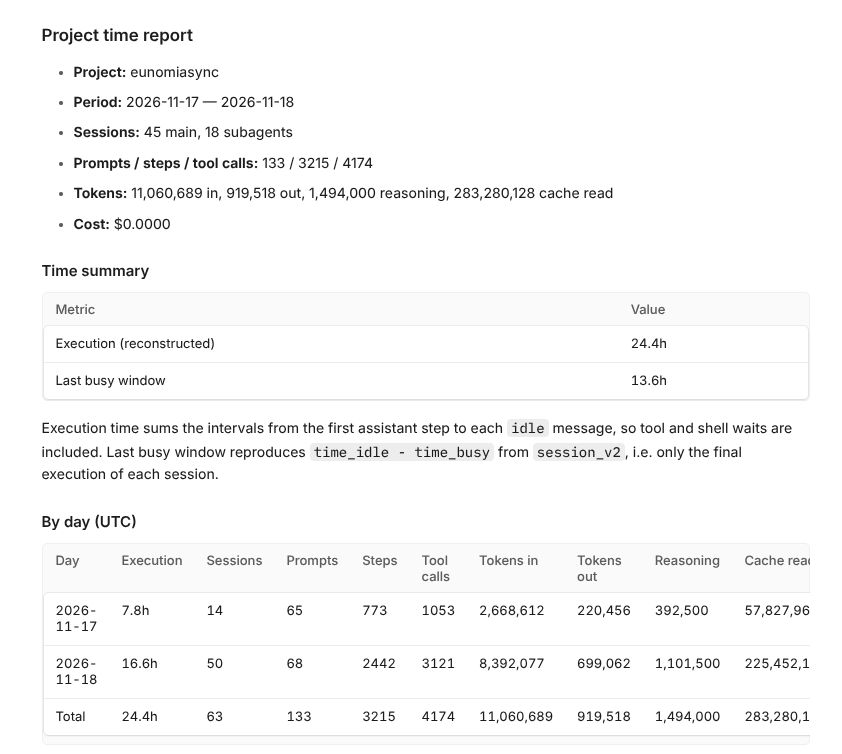

# opencode-project-time

> **V2-only:** this plugin targets the OpenCode 2 plugin API (`@opencode/plugin`,
> `Plugin.define`). It does not load in OpenCode 1. The standalone `collect.py`
> and `report.py` scripts can still be run directly.

An OpenCode plugin that reports how much time **agents** spent on a project —
not the wall-clock time people spent in the editor. It reconstructs agent
execution time from OpenCode's own session records, using only read-only
queries against its local SQLite database.



The package contains four parts:

- `src/index.ts` — the server plugin: registers the skill, a `time_project_report`
  tool, and the `/project-time` command.
- `skill/SKILL.md` — the skill that drives a report from natural-language
  requests such as "how long did we work on EunomiaSync?".
- `scripts/collect.py` and `scripts/report.py` — the data collector and the
  Markdown renderer. They work without the plugin.
- `REPORT_FORMAT.md` — the report contract; `examples/sample-report.md` is a
  short example with synthetic data.

## Safety

`collect.py` opens OpenCode's SQLite database with a `mode=ro` URI and
enables `PRAGMA query_only = ON`. By default the path is
`~/.local/share/opencode/opencode.db` (`$XDG_DATA_HOME/opencode/opencode.db` on
Linux, the platform application-data directory on macOS and Windows); override
it with `--db`. It never modifies database contents or
committed WAL frames. SQLite may create or attach the read-only WAL-index
(`-shm`) side file while reading, so a database in a directory without write
permission may be unreadable. The only files this project writes are the JSON
snapshot and Markdown report you pass with `--out`. OpenCode configuration files
are not touched.

## Defaults

- **Project:** the current project, resolved from the working directory (canonical
  checkout, a parent directory named after the project, or a recorded session
  directory). If it cannot be identified, the collector exits with an error that
  asks for the project name explicitly. `--project NAME` or `--dir PATH` override
  the default; both flags may be repeated.
- **Period:** all recorded sessions. `--since` and `--until` accept ISO-8601
  timestamps and narrow the selection.
- **Child sessions:** included. Use `--main-only` when a report should contain
  only main sessions; this is the only flag that reduces the default scope.

## Usage without the plugin

Current project, all sessions:

```sh
python3 scripts/collect.py --out var/current-snapshot.json
python3 scripts/report.py var/current-snapshot.json --out var/current-report.md
```

Named project and period, main sessions only:

```sh
python3 scripts/collect.py --project EunomiaSync \
  --since 2026-11-17T00:00:00Z --until 2026-11-18T23:59:59Z \
  --main-only --out var/eunomiasync-main-snapshot.json
python3 scripts/report.py var/eunomiasync-main-snapshot.json \
  --out var/eunomiasync-main-report.md
```

The `--project` value matches an OpenCode project name, a checkout directory
basename, or a project id. Use `--dir PATH` to select a canonical checkout,
including its worktrees. `--db PATH` overrides the database location.

## Example requests to the skill

| Request | Effective parameters |
| --- | --- |
| "How long did we work on this project?" | current project, all sessions, child sessions included |
| "Time report for EunomiaSync" | `--project EunomiaSync`, all sessions, child sessions included |
| "Report for EunomiaSync for the last two days" | `--project EunomiaSync`, `--since`/`--until` for those days, child sessions included |
| "Only main sessions on EunomiaSync, all time" | `--project EunomiaSync`, `--main-only` |

When the project is not named and the current directory cannot be resolved, the
skill should relay the error and ask the owner which project to collect.

## Plugin entry points

All three entry points call the same generator; only the way of specifying
parameters differs. Generated files are named
`<slug>-snapshot-<YYYYMMDDHHMM>.json` and `<slug>-report-<YYYYMMDDHHMM>.md`,
where the stamp is the UTC generation time. Running the generator twice within
the same minute overwrites the previous pair.

- **Skill** — natural language, for example «How long did we work on this
  project?». The skill drives `collect.py` and `report.py`.
- **Tool** `time_project_report` (`tools.time.project_report` in Code Mode) —
  for agents. It accepts `project`, `directory`, `since`, `until`, and
  `mainOnly`; with no arguments it uses the plugin's current location.
- **Command** `/project-time` — for the user, executes the report directly and
  posts the file paths into the session as a synthetic message. No model turn
  is required.

Command syntax:

```text
/project-time [PROJECT | --project NAME | --dir PATH] [--since ISO] [--until ISO] [--main-only]
```

Examples:

```text
/project-time
/project-time EunomiaSync
/project-time --project EunomiaSync --since 2026-11-17T00:00:00Z --until 2026-11-18T00:00:00Z
/project-time --dir /home/brooks/projects/business/EunomiaSync --main-only
```

`--main-only` reproduces the older narrow scope; the default includes child
sessions. Invalid arguments produce a usage message instead of a report.

## Metrics

| Metric | Definition | What it includes |
| --- | --- | --- |
| Execution | First assistant message to each `idle` message in `session_message` | Model work, tool calls, waiting for shell and subagent results |
| Last busy window | `time_idle - time_busy` in `session_v2` | Only the final execution of a session |

Wall-clock session duration is not collected or reported: waiting for the next
prompt is not work. OpenCode stores only the final `busy`/`idle` timestamps per
session, so older execution windows have to be reconstructed from the message
stream.

**By day (UTC):** execution intervals are split at midnight. Prompts, steps,
and tool calls are attributed to the UTC day of the message that produced
them. Tokens are stored per session in `session_v2`; message-level usage is
attributed to the day of each assistant message, and the remainder — for
example an unfinished last step with no recorded tokens — is attributed to the
session's creation day, so the day rows always sum to the report totals. The
Sessions column counts sessions with activity on that day, so a session
spanning midnight is counted on both days; the Total row shows unique sessions
(main plus subagents).

## Installing the plugin

Requires OpenCode 2, Node.js with npm, and Python 3 on `PATH`. The plugin reads
`~/.local/share/opencode/opencode.db` read-only; no database setup is needed.

Install the package from GitHub:

```sh
opencode plugin add github:yepbro/opencode-project-time
```

`plugin add` installs the package and adds it to `plugins` in the global
`~/.config/opencode/opencode.jsonc`. You can also add the specifier manually:

```jsonc
{
  "$schema": "https://opencode.ai/config.json",
  "plugins": ["github:yepbro/opencode-project-time"]
}
```

Configuration changes are picked up automatically. If the plugin does not show
up right after installation, run `opencode service restart`. Verify with:

```sh
opencode plugin list
```

The list should include `opencode-project-time`. Open a session and run
`/project-time` or ask "How long did we work on this project?".

Optional options can be set with the object form, for example to move the
reports out of the installed package's `var/` directory:

```jsonc
{
  "plugins": [
    {
      "package": "github:yepbro/opencode-project-time",
      "options": {
        "dbPath": "/path/to/opencode.db",
        "outputDir": "/path/to/writable/report-dir"
      }
    }
  ]
}
```

To remove the plugin:

```sh
opencode plugin remove github:yepbro/opencode-project-time
```

## Tests

```sh
npm test
# or individually:
python3 -m unittest discover -s tests -v
node --test tests/command.test.mjs
```

The Python tests build a synthetic SQLite database with the relevant OpenCode
tables. They check scope matching, worktree inclusion, daily splitting and
per-day attribution of prompts, steps, tool calls, and tokens, subagent
handling, time filters, the read-only guard, and the rendered Markdown.
The Node test transpiles `src/index.ts`, stubs `@opencode/plugin` and `python3`,
then checks command argument parsing and that both entry points pass the right
flags and write both output files. The TypeScript compiler is a dev dependency
installed by `npm install`; set `TS_MODULE` to override its location.

## Validation data

The maintainer validates against a local OpenCode project named EunomiaSync;
it is not shipped with this repository. To reproduce the check against one of
your own projects, replace the name:

```sh
python3 scripts/collect.py --project EunomiaSync --out var/eunomiasync-snapshot.json
python3 scripts/report.py var/eunomiasync-snapshot.json --out var/eunomiasync-report.md
```

Generated files go to `var/`, which is gitignored. Files written by the plugin
itself carry a `YYYYMMDDHHMM` UTC stamp; these manual CLI examples do not.

## License

MIT — see [LICENSE](LICENSE). The plugin uses the same permissive license as
OpenCode itself and `@opencode/plugin`.

Harness: OpenCode. Model: Hy4 Flash.
